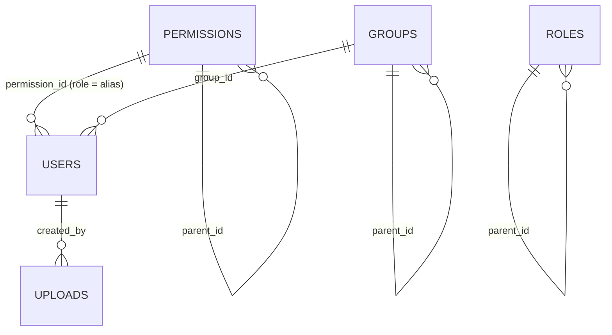

# Database Schema

The data model of `apps/backend`. It is identical for both database providers.

| | MongoDB (`BE_DB_PROVIDER=mongo`, default) | Supabase Postgres (`BE_DB_PROVIDER=supabase`) |
|---|---|---|
| Driver | pymongo (`db/mongo/`) | psycopg 3 + psycopg_pool (`db/supabase/`; SQL is composed only with `psycopg.sql`) |
| Container | collection | table in `BE_SUPABASE_DB_SCHEMA` (default `public`) |
| Primary key | `_id` = app-generated UUID v4 string (exposed as `id`) | `id uuid primary key` (same app-generated value) |
| JSON / list fields | native documents and arrays | `jsonb` |
| Timestamps | BSON date (UTC, ms precision) | `timestamptz` (UTC, ms precision) |
| Unique rules | unique indexes `uniq_<field>` (partial for nullable fields), created on startup by `db/mongo/indexes.py` | constraints `<table>_<field>_key`, from `migrations/supabase/*.sql` |
| Lookup indexes | `idx_created_at`, `idx_<ref>_id`, created on startup | `<table>_created_at_idx`, `<table>_<ref>_idx`, from migrations |
| Referential integrity | checked by services (422 for missing refs, 409 when deleting referenced rows) | the same service checks, plus FKs `on delete set null` |
| Schema changes | none needed (new keys read as the default/None) | a new idempotent migration file |

**Source of truth:** `apps/backend/db/schema.py` (`EntitySchema` declarations). It drives write
validation, Mongo indexes, query whitelists and camelCase API names. Keep
`apps/backend/migrations/supabase/*.sql` in sync with it.

## Conventions

- Storage names are **snake_case** (`created_at`, `permission_id`). The JSON API uses **camelCase**
  (`createdAt`, `permissionId`), converted by the DTOs.
- Every entity has `id`, `created_by` (the actor's user id, `"seed"` for seeded rows), `created_at` and
  `updated_at` (`audit_fields()`).
- IDs are `str(uuid.uuid4())`, generated by the app. Never derive ids from content.
- Every declared field is always present on insert (declared defaults are filled), so Mongo documents
  and Postgres rows have the same shape.
- Emails are stored lowercased. Uniqueness is case-sensitive, so always normalise before writing.
- `sensitive` fields (`password_hash`, `two_factor_secret`) can never be filtered, sorted or searched,
  and they are never part of a response model. `two_factor_secret` is Fernet-encrypted when
  `BE_DATA_ENCRYPTION_KEY` is set.
- Collection and table names are configurable (`BE_TABLE_USERS`, `BE_TABLE_PERMISSIONS`,
  `BE_TABLE_GROUPS`, `BE_TABLE_ROLES`, `BE_TABLE_UPLOADS`). The SQL migrations assume the defaults.
- Supabase lockdown: every table has RLS enabled with no policies, and `anon`/`authenticated` grants are
  revoked. Only the backend (table owner or service role) can read them.

## Relations



- `users.permission_id` → `permissions.id`. This is the RBAC link; the user's `role` is the
  permission's `alias`.
- `users.group_id` → `groups.id`.
- `parent_id` self-references build trees. Services reject cycles (422). Deleting a parent detaches its
  children. Deleting a permission or group that users still reference returns 409.
- `created_by` is a plain text reference (a user id or `"seed"`), not a foreign key.

## Entities

`Query` flags: **f** = filterable, **s** = searchable, **o** = sortable in `POST /x/get-all`. Fields
marked "—" cannot be used in queries. Some fields are internal and not part of any response model
(`externalId`, `bucket`).

### Value constraints (Postgres CHECKs; enforced by DTOs in both providers)

| Table.field | Allowed |
|---|---|
| `users.status` | `pending`, `active`, `blocked`, `deleted` (default `pending`; admin-created users default to `active`) |
| `users.auth_provider` | `local`, `google`, `supabase` |
| `users.two_factor_method` | `email`, `totp`, or null |
| `permissions.privileges`, `uploads.tags` | JSON array |

### `users`

| Field (storage) | API (JSON) | Type | Postgres column | Unique | Query (f/s/o) |
|---|---|---|---|---|---|
| `id` | `id` | id | `uuid primary key default gen_random_uuid()` |  | f |
| `username` | `username` | str | `text not null` | yes | fso |
| `fullname` | `fullname` | str | `text` |  | fso |
| `email` | `email` | str | `text not null` | yes | fso |
| `phone` | `phone` | str | `text` | yes | fs |
| `password_hash` | `passwordHash` | str | `text` |  | secret (never queryable/returned) |
| `permission_id` | `permissionId` | id | `uuid references public.permissions (id) on delete set null` |  | f |
| `group_id` | `groupId` | id | `uuid references public.groups (id) on delete set null` |  | f |
| `status` | `status` | str | `text not null default 'pending'` |  | fo |
| `email_verified` | `emailVerified` | bool | `boolean not null default false` |  | f |
| `multi_login` | `multiLogin` | bool | `boolean not null default true` |  | f |
| `expired_at` | `expiredAt` | datetime | `timestamptz` |  | fo |
| `last_login_at` | `lastLoginAt` | datetime | `timestamptz` |  | fo |
| `two_factor_enabled` | `twoFactorEnabled` | bool | `boolean not null default false` |  | f |
| `two_factor_method` | `twoFactorMethod` | str | `text` |  | — |
| `two_factor_secret` | `twoFactorSecret` | str | `text` |  | secret (never queryable/returned) |
| `about` | `about` | str | `text` |  | — |
| `image` | `image` | str | `text` |  | — |
| `settings` | `settings` | json | `jsonb` |  | — |
| `personalization` | `personalization` | json | `jsonb` |  | — |
| `additional` | `additional` | json | `jsonb` |  | — |
| `auth_provider` | `authProvider` | str | `text not null default 'local'` |  | f |
| `external_id` | `externalId` | str | `text` | yes | — |
| `created_by` | `createdBy` | str | `text` |  | f |
| `created_at` | `createdAt` | datetime | `timestamptz not null default now()` |  | fo |
| `updated_at` | `updatedAt` | datetime | `timestamptz not null default now()` |  | fo |

### `permissions`

| Field (storage) | API (JSON) | Type | Postgres column | Unique | Query (f/s/o) |
|---|---|---|---|---|---|
| `id` | `id` | id | `uuid primary key default gen_random_uuid()` |  | f |
| `name` | `name` | str | `text not null` |  | fso |
| `alias` | `alias` | str | `text` | yes | fso |
| `description` | `description` | str | `text` |  | s |
| `type` | `type` | str | `text` |  | f |
| `privileges` | `privileges` | list | `jsonb not null default '[]'::jsonb` |  | f |
| `parent_id` | `parentId` | id | `uuid references public.permissions (id) on delete set null` |  | f |
| `image` | `image` | str | `text` |  | — |
| `created_by` | `createdBy` | str | `text` |  | f |
| `created_at` | `createdAt` | datetime | `timestamptz not null default now()` |  | fo |
| `updated_at` | `updatedAt` | datetime | `timestamptz not null default now()` |  | fo |

### `groups`

| Field (storage) | API (JSON) | Type | Postgres column | Unique | Query (f/s/o) |
|---|---|---|---|---|---|
| `id` | `id` | id | `uuid primary key default gen_random_uuid()` |  | f |
| `name` | `name` | str | `text not null` |  | fso |
| `description` | `description` | str | `text` |  | s |
| `parent_id` | `parentId` | id | `uuid references public.groups (id) on delete set null` |  | f |
| `settings` | `settings` | json | `jsonb` |  | — |
| `filters` | `filters` | json | `jsonb` |  | — |
| `image` | `image` | str | `text` |  | — |
| `personalization` | `personalization` | json | `jsonb` |  | — |
| `created_by` | `createdBy` | str | `text` |  | f |
| `created_at` | `createdAt` | datetime | `timestamptz not null default now()` |  | fo |
| `updated_at` | `updatedAt` | datetime | `timestamptz not null default now()` |  | fo |

### `roles`

| Field (storage) | API (JSON) | Type | Postgres column | Unique | Query (f/s/o) |
|---|---|---|---|---|---|
| `id` | `id` | id | `uuid primary key default gen_random_uuid()` |  | f |
| `name` | `name` | str | `text not null` |  | fso |
| `alias` | `alias` | str | `text` |  | fso |
| `description` | `description` | str | `text` |  | s |
| `role_position` | `rolePosition` | int | `integer` |  | fo |
| `type` | `type` | str | `text` |  | f |
| `parent_id` | `parentId` | id | `uuid references public.roles (id) on delete set null` |  | f |
| `workspace_id` | `workspaceId` | str | `text` |  | f |
| `organization_id` | `organizationId` | str | `text` |  | f |
| `created_by` | `createdBy` | str | `text` |  | f |
| `created_at` | `createdAt` | datetime | `timestamptz not null default now()` |  | fo |
| `updated_at` | `updatedAt` | datetime | `timestamptz not null default now()` |  | fo |

### `uploads`

| Field (storage) | API (JSON) | Type | Postgres column | Unique | Query (f/s/o) |
|---|---|---|---|---|---|
| `id` | `id` | id | `uuid primary key default gen_random_uuid()` |  | f |
| `bucket` | `bucket` | str | `text not null` |  | — |
| `object_key` | `objectKey` | str | `text not null` | yes | — |
| `filename` | `filename` | str | `text not null` |  | fso |
| `mime_type` | `mimeType` | str | `text` |  | fo |
| `filesize` | `filesize` | int | `bigint` |  | fo |
| `folder` | `folder` | str | `text` |  | fs |
| `tags` | `tags` | list | `jsonb not null default '[]'::jsonb` |  | f |
| `widget_id` | `widgetId` | str | `text` |  | f |
| `dashboard_id` | `dashboardId` | str | `text` |  | f |
| `workspace_id` | `workspaceId` | str | `text` |  | f |
| `connection_id` | `connectionId` | str | `text` |  | f |
| `created_by` | `createdBy` | str | `text` |  | f |
| `created_at` | `createdAt` | datetime | `timestamptz not null default now()` |  | fo |
| `updated_at` | `updatedAt` | datetime | `timestamptz not null default now()` |  | fo |

## Adding or changing schema

### New field on an existing entity

1. `apps/backend/db/schema.py`: add `_f("field_name", FieldType.X, q="f", nullable=True, default=None)`.
   Set `unique=True` for uniqueness and `sensitive=True` for secrets.
2. Postgres: add a **new** file such as `apps/backend/migrations/supabase/002_users_nickname.sql`:
   ```sql
   begin;
   alter table public.users add column if not exists nickname text;
   -- unique:  alter table public.users add constraint users_nickname_key unique (nickname);
   commit;
   ```
   Never edit an applied migration. Name constraints `<table>_<field>_key` (unique) and
   `<table>_<field>_check` (check) so the repository can map violations back to the API field.
3. Mongo: nothing to migrate. Unique indexes are created on the next startup. Existing documents
   without the key read as missing; backfill with a script in `apps/backend/scripts/` if needed.
4. Expose it in the DTOs (`dto/<module>.py`: create, update, response), then update the tests, this file
   and `docs/api/<module>.md`.

### New entity

See `apps/backend/AI_GUIDE.md` §5.1. In short: declare an `EntitySchema` in `db/schema.py` and add it to
`ENTITIES`; add `TABLE_<X>` to `core/config.py` and `.env.example`; add
`migrations/supabase/NNN_<x>.sql` with an `id uuid primary key`, the audit columns, the
`set_updated_at` trigger, and the RLS lockdown block; then add the repository dependency, DTOs, service,
router, registry entry, tests and docs.

### Applying migrations

- Supabase dashboard: SQL Editor → paste the file → Run.
- psql: `psql "$BE_SUPABASE_DB_URL" -v ON_ERROR_STOP=1 -f apps/backend/migrations/supabase/001_init.sql`.
- Local Docker Postgres: `DB_PROVIDER=supabase docker compose --profile postgres up -d --build` applies
  `scripts/docker/postgres/00-supabase-compat.sql` and then every migration, on the first start of an
  empty volume. After changing migrations, run `docker compose --profile postgres down -v`.
- The backend never runs DDL. It only verifies that the tables exist (startup log and
  `/health/ready`).

Details: [`apps/backend/migrations/supabase/README.md`](../apps/backend/migrations/supabase/README.md).
